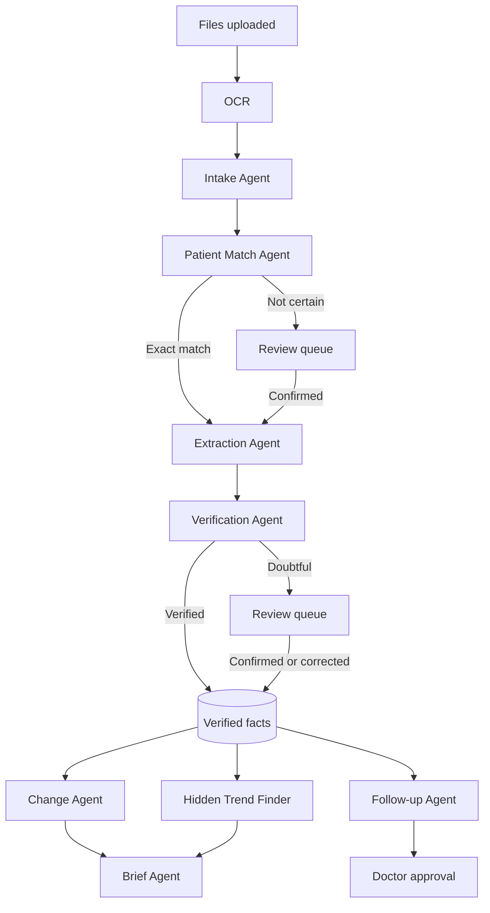

# 3. Agent design

## Design principle

Use AI where judgment is needed, and use code where exact answers are needed.

- **AI handles:** reading messy documents, understanding language, and drafting text.
- **Code handles:** trends, dates, unit conversion, comparisons, alerts and access rules.
- **People handle:** uncertain matches, doubtful values and final approval.

Most agents are controlled workflow steps, because document processing has a known order and an error must be easy to trace. The Ask Agent is the only open-ended agent that chooses its own tools.

## The 11 agents

| Agent | Input | Output | Type | Human checkpoint |
|---|---|---|---|---|
| **Intake** | Uploaded PDF or images | Separate documents, page order and document type | Workflow step | Low-confidence types go to review |
| **Patient Match** | Names, IDs and dates in the document | Suggested patient and confidence | Code + AI | Required unless two identifiers match exactly |
| **Extraction** | Page image and OCR lines | Labs, medicines, diagnoses and dates, with source line IDs | Workflow step | None directly |
| **Verification** | Extracted fact and its source | Verified or needs review | Code + separate AI check | Doubtful items go to review |
| **Change** | Verified facts and last visit date | Changes, trends and missing records | Code + AI wording | Doctor reads the result |
| **Brief** | Verified facts and changes | Short sourced brief | Workflow step | Doctor reads the result |
| **Follow-up** | Verified records and clinic follow-up rules | Overdue items and reminder drafts | Code + AI drafting | Approval required before a draft is marked ready |
| **Ask** | Doctor's question | Sourced answer | Tool-using agent | Doctor verifies through sources |
| **Scribe** | Dictation transcript | Note and prescription drafts | Workflow step | Approval required |
| **Document** | Approved record data | Urdu sheet, referral letter or certificate draft | Workflow step | Approval required |
| **Daily Ops** | Day's activity and pending items | End-of-day list | Code + AI wording | Doctor reads the result |

## Workflow

## Verification rules

A value becomes **verified** only if all these checks pass:

1. **Source exists:** The fact points to real OCR lines on a real page.
2. **Text match:** The number, unit or medicine name appears in the cited line, allowing for known OCR confusions such as 0 and O.
3. **Valid format:** The value is plausible for that test and unit. A value outside the plausible range is sent to review, not changed.
4. **Second read:** A separate AI call reads the cropped source area without seeing the first answer, and the two readings must agree.
5. **Date check:** The report date is present and is not in the future.

Any failure sends the item to the review queue with the reason shown. Unverified values never appear as facts in trends, briefs or alerts.

## Ask Agent tools

| Tool | Purpose |
|---|---|
| `get_patient_summary` | Reads conditions, allergies and current medicines |
| `get_lab_trend` | Returns a lab's values and dates by code |
| `get_medicine_history` | Returns medicine events by date |
| `get_changes_since` | Returns changes since a given date |
| `search_documents` | Finds relevant document text by keyword and meaning |
| `get_source` | Returns the source page and highlight for a fact |

**Rules:**

- Tools are limited to the currently open patient by code, not by the prompt.
- Every factual claim must carry a source reference, and code rejects answers with unknown references.
- If nothing is found, the agent says the record does not contain the answer.
- Questions asking for a diagnosis or treatment get a clear response that ClinicMind can only report what is in the record.
- Text inside uploaded documents is treated as data. It can never give the agent instructions.

## Scribe Agent rules

- A prescription draft may contain only medicines the doctor dictated.
- Code compares each drafted medicine, dose and duration with the transcript, and any mismatch blocks approval until it is resolved.
- Unclear drug names are marked for the doctor to confirm, not guessed.

## Claude API implementation notes

Checked against the Claude API guidance on 7 November 2026. Recheck these when the code is written.

| Topic | Decision |
|---|---|
| **Model** | `claude-opus-5-5` for all agents at first. Any cheaper model must first pass the same [evaluation](11-evaluation.md). |
| **Thinking and effort** | Thinking cannot be disabled on this model. Set `output_config.effort` explicitly for each agent, because the default is `medium`. |
| **Structured results** | Use `output_config.format` with a schema for extraction and verification. |
| **Tool choice** | Forced tool choice returns an error on this model. Use `auto`, `strict: true` tools and clear instructions. |
| **Source references** | API citations cannot be combined with structured output and give page-level PDF locations. ClinicMind therefore uses its own OCR line IDs. |
| **Morning brief** | Prepared ahead of time. Batch processing can be used if it costs less and timing allows. |
| **Long responses** | Use streaming for long requests. |
| **Refusals** | Check `stop_reason` before reading content. Enable the server-side fallback when the code is written, and send anything still refused to the review queue. |
