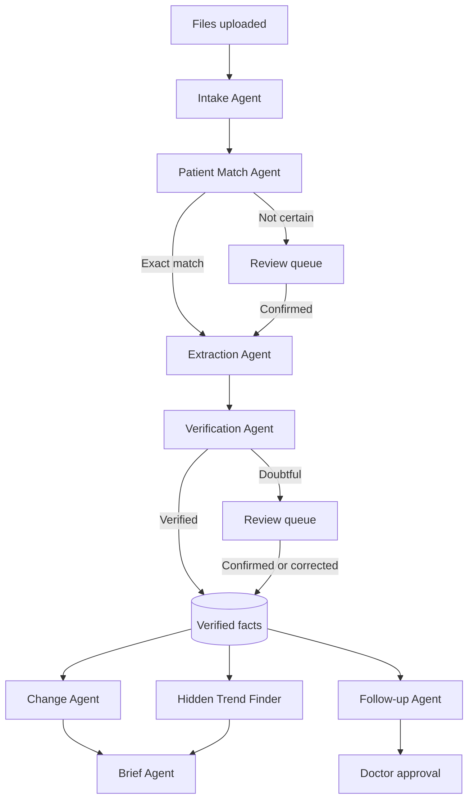

# 3. Agent design

## Design principle

Use AI where judgment is needed, and use code where exact answers are needed.

- **AI handles:** reading messy documents, understanding language, and drafting text.
- **Code handles:** trends, dates, unit conversion, comparisons, alerts and access rules.
- **People handle:** uncertain matches, doubtful values and final approval.

Most agents are controlled workflow steps, because document processing has a known order and an error must be easy to trace. The Ask Agent is the only open-ended agent that chooses its own tools.

## The 11 agents

| Agent | Input | Output | Type | Human checkpoint |
|---|---|---|---|---|
| **Intake** | Uploaded PDF or images | Separate documents, page order and document type | Workflow step | Low-confidence types go to review |
| **Patient Match** | Name and file number in the document | Suggested patient | Code only | Required unless both match exactly |
| **Extraction** | Page image | Labs, medicines, diagnoses and dates, with their positions on the page | Same AI call as Intake | None directly |
| **Verification** | Extracted fact and its source | Verified or needs review | Code + separate AI check | Doubtful items go to review |
| **Change** | Verified facts and last visit date | Changes, trends and missing records | Code only | Doctor reads the result |
| **Brief** | Verified facts and changes | Short sourced brief | Workflow step | Doctor reads the result |
| **Follow-up** | Verified records and clinic follow-up rules | Overdue items and reminder drafts | Code + AI drafting | Approval required before a draft is marked ready |
| **Ask** | Doctor's question | Sourced answer | Tool-using agent | Doctor verifies through sources |
| **Scribe** | Dictation transcript | Note and prescription drafts | Workflow step | Approval required |
| **Document** | Approved record data | Urdu sheet, referral letter or certificate draft | Workflow step | Approval required |
| **Daily Ops** | Day's activity and pending items | End-of-day list | Code only | Doctor reads the result |

## Workflow

## Verification rules

A lab value becomes **verified** only if all these checks pass:

1. **Known test:** The test name is on the reference list.
2. **Valid value:** The value is a number in a plausible range, with the expected unit.
3. **Location:** Its position on the page is valid.
4. **Confidence:** The AI is confident in its reading.
5. **Second reading:** A separate AI call reads the page again, and the values must match.

Medicines also go to a person if the AI reports any doubt. Allergies and conditions must have a valid position and high confidence. A page with no readable name or file number is treated as unreadable.

Any failure sends the item to **Needs Checking** with the reason shown. Unverified values never appear as facts in trends, briefs or alerts.

## Ask Agent tools

| Tool | Purpose |
|---|---|
| `get_patient_summary` | Reads conditions, allergies and recorded medicines |
| `get_changes_since_last_visit` | Returns changes since the last visit |
| `get_missing_records` | Returns overdue or missing records |
| `get_lab_history` | Returns a lab's values and dates |
| `get_medicine_history` | Returns recorded medicines by date |
| `search_documents` | Finds document text by keyword |

**Rules:**

- Tools are limited to the currently open patient by code, not by the prompt.
- Every factual claim must carry a source reference, and code rejects answers with unknown references.
- If nothing is found, the agent says the record does not contain the answer.
- Questions asking for a diagnosis or treatment get a clear response that ClinicMind can only report what is in the record.
- Text inside uploaded documents is treated as data. It can never give the agent instructions.

## Scribe Agent rules

- A prescription draft may contain only medicines the doctor dictated.
- Code compares each drafted medicine, dose and duration with the transcript, and any mismatch blocks approval until it is resolved.
- Unclear drug names are marked for the doctor to confirm, not guessed.

## Gemini implementation notes

| Topic | Decision |
|---|---|
| **Models** | The free tier limits each model to a small number of daily requests, so the app moves through a list of free models. See [Architecture](04-architecture.md). |
| **Structured results** | JSON responses are read and then checked by code. |
| **Source positions** | Gemini returns each fact's position on the page. |
| **Speech** | Gemini hears the dictation audio directly, so no separate speech service is needed. |
| **Urdu** | Some models answer in Roman letters or Hindi script, so code checks the script before an answer is shown. |
