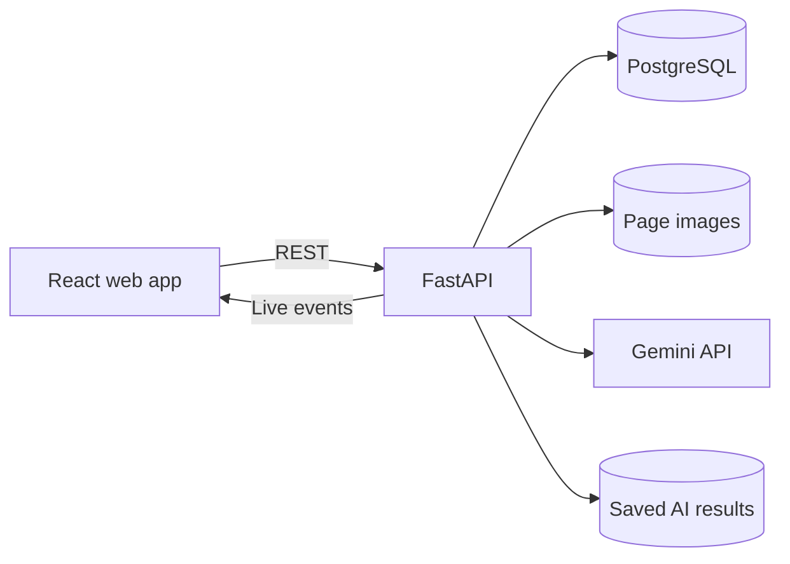

# 4. Architecture

## Tech stack

| Layer | Choice | Why |
|---|---|---|
| **Frontend** | React, TypeScript, Vite | Fast to build and simple to run |
| **3D** | Three.js with React Three Fiber | Patient Story Replay in the browser, with a body built in code so no licensed model is needed |
| **Charts** | Small custom SVG charts | Enough for lab trends, with no extra library |
| **Backend** | Python, FastAPI | Strong AI and document libraries |
| **Database** | PostgreSQL | Reliable structured facts for trends and comparisons |
| **Search** | PostgreSQL full-text search | Enough for one patient's documents |
| **Background work** | A worker thread in the API | Simple enough for a demo |
| **Live updates** | Server-Sent Events (SSE) | Simple one-way updates for the Agent Board |
| **AI** | Gemini API (free tier) | Reads images, locates text, hears audio and uses tools |
| **Local setup** | Docker Compose | One-command demo setup |

## System overview



## Key technical decisions

### 1. Facts go in a table, and code does the maths

Lab values, medicines, allergies and conditions are stored as structured rows. Code calculates trends and changes from them, because numbers from a database are repeatable and an AI recalculating them may not be.

### 2. Gemini provides the highlight positions

The planned OCR step was replaced after testing. Gemini returns each value with the position of its row on the page. On the demo documents, this placed all 25 lab highlights on the correct row, with far less to build and run.

**Limit:** This has been tested only on made-up documents.

### 3. Hidden Trend Finder is code, not AI

A slow change is reported only when all these checks pass:

- At least 4 verified values for the same test
- A span of at least 6 months
- A consistent direction, using a Mann-Kendall trend test
- A change in the direction worth watching, such as hemoglobin falling
- A total change above a threshold set for that test

The sentence shown to the doctor comes from a fixed template, so it cannot add a cause or a diagnosis. Thresholds are in `backend/app/reference.py` and must be reviewed by a doctor.

### 4. Replay is built from verified data

The replay engine turns verified facts into a time-ordered script. A lookup table connects each test to a body region, for example creatinine to the kidneys. AI is not involved, so the replay is repeatable and cannot invent medical links.

### 5. Safety alerts use a curated list

A small medicine list maps brands to ingredients and groups. Code compares each prescribed medicine with recorded allergies and medicines.

**Limit:** The list covers demo medicines only. "No alert" does not mean a prescription is safe, and the screen says so.

### 6. Saved AI results keep the demo reliable and free

Every AI result is saved in `demo-data/cache`, keyed by its exact input. The same input never calls the API twice, so a reset costs no quota and the demo works offline after the first run. The Agent Board shows a **Saved run** label when it replays these results.

### 7. The free tier shapes the design

During the build, the free tier allowed 20 requests per day per model. The app therefore:

- Waits between live calls
- Moves to the next free model when one model's daily limit is used up
- Uses one API key, without rotating keys to get around limits

Free-tier data may be used by the provider to improve its products, so only made-up data may be used with this setup.

### 8. Every AI step is recorded

Each agent step writes to the activity log, including who acted and whether a saved result was used.

## Main data flow

1. A user uploads files, and the API starts a background batch.
2. Each page is read, and Patient Match decides whether it can be attached.
3. A second reading and code checks decide which values are verified.
4. Verified facts update the timeline, trends, changes and brief.
5. Each step sends an event to the Agent Board.

## Folder plan

```text
backend/app/
├── main.py            API routes
├── pipeline.py        Runs files through the agents
├── seed.py            Loads the demo data
├── evaluate.py        Measures accuracy
├── reference.py       Lab tests, medicines and follow-up rules
├── ai.py              Gemini calls, pacing and saved results
├── agents/            The AI helpers
└── services/          Trends, replay and safety alerts

frontend/src/
├── pages/             One file per screen
├── components.tsx     Source viewer and charts
└── Body3D.tsx         3D body for the replay
```

## Environment settings

Secrets stay in a local `.env` file, which is never committed. See [.env.example](../.env.example).
