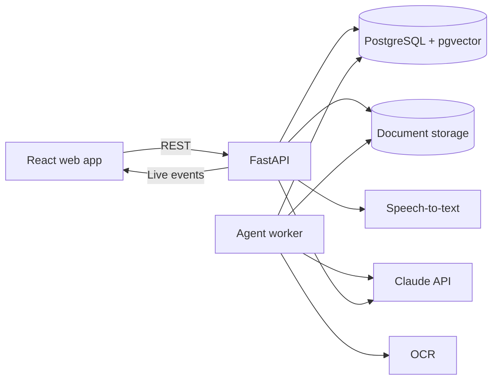

# 4. Architecture

## Tech stack

| Layer | Choice | Why |
|---|---|---|
| **Frontend** | React, TypeScript, Vite | Requested stack, fast to build |
| **3D** | Three.js with React Three Fiber | Patient Story Replay in the browser |
| **Charts** | Recharts | Lab trends |
| **Backend** | Python, FastAPI | Strong AI and document libraries |
| **Database** | PostgreSQL | Reliable structured facts for trends and comparisons |
| **Search** | PostgreSQL full-text search and pgvector | Keeps documents and facts in one database |
| **Background work** | Worker using a PostgreSQL jobs table | No extra queue system for a demo |
| **Live updates** | Server-Sent Events (SSE) | Simple one-way updates for the Live Agent Board |
| **AI** | Claude API (`claude-opus-5-5`) | Vision, structured results and tool use |
| **OCR** | PaddleOCR first, to be confirmed in Phase 1 | Provides line positions for highlighting |
| **Speech-to-text** | Soniox or Whisper, to be chosen in Phase 1 | Claude API does not transcribe audio |
| **Embeddings** | BGE-M3 first, to be confirmed in Phase 1 | Multilingual search that can run locally |
| **Local setup** | Docker Compose | One-command demo setup |

## System overview



## Key technical decisions

### 1. Facts go in tables, and text goes in search

Lab values and medicines are stored as structured rows, and code calculates trends and changes from them. Retrieval (RAG) is used only for free text, such as notes.

**Why:** Numbers from a database are repeatable, while an LLM recalculating them may not be.

### 2. Source highlighting uses OCR positions

OCR provides each line's position on the page. The Extraction Agent receives the page image and numbered OCR lines, and it returns the line IDs for each fact. Code then converts those IDs to highlight boxes.

**Why:** Exact highlights need reliable coordinates, and the API's PDF citations only go down to page level.

**Fallback:** If handwriting produces poor OCR, the app shows a larger page region, marks it "approximate", and sends the fact to review.

### 3. Hidden Trend Finder is code, not AI

A trend is reported only when all these checks pass:

- At least 4 verified values for the same test, in the same or converted units
- A span of at least 6 months
- A consistent direction, using a Mann-Kendall trend test
- A total change above a threshold set for that test

AI only writes the plain-English sentence, using the calculated numbers. It cannot add a cause or a diagnosis.

The test list and thresholds are stored in `backend/app/services/` and must be reviewed by a doctor before the demo.

### 4. Replay is built from verified data

The replay engine turns verified events into a time-ordered script. A reviewed lookup table connects each test or condition to a body region, for example creatinine to the kidneys.

**Why:** This keeps the visual repeatable and prevents AI from inventing medical links. A highlighted region shows where a test relates to the body. It does not show disease.

**Fallback:** If a suitable 3D model cannot be used, the replay uses a clean 2D body diagram with the same data.

### 5. Safety alerts use a curated list

A small reviewed medicine list maps brands to ingredients and allergy classes. Code compares each prescribed medicine with recorded allergies and current medicines. AI does not decide whether an alert fires.

**Limit:** The list covers demo medicines only. "No alert" does not mean a prescription is safe, and the screen says so.

### 6. Every AI result is traceable

Each agent run stores its input references, output, model, prompt version, duration and token use. This powers the activity log and accuracy testing.

### 7. Demo Mode protects the live demo

Demo Mode can load saved results from a tested earlier run if an external service fails. The screen shows a "Saved run" label, so the demo stays honest.

## Main data flow

1. A user uploads files, and the API stores them and creates jobs.
2. The worker runs OCR, then the Intake and Patient Match agents.
3. The Extraction and Verification agents create facts or review items.
4. Verified facts update the timeline, trends, changes and brief.
5. Each step sends an event to the Live Agent Board.

## Folder plan

```text
backend/app/
├── main.py            API startup
├── api/               API routes
├── agents/            One file per agent
├── services/          OCR, trends, replay, alerts, follow-up rules
├── models/            Database tables
├── prompts/           Versioned prompts
└── worker.py          Background job runner

frontend/src/
├── pages/             One folder per screen
├── components/        Shared interface parts
├── replay/            3D body and replay player
└── api/               Backend client
```

## Environment settings

Secrets stay in a local `.env` file, which is never committed. See [.env.example](../.env.example).
