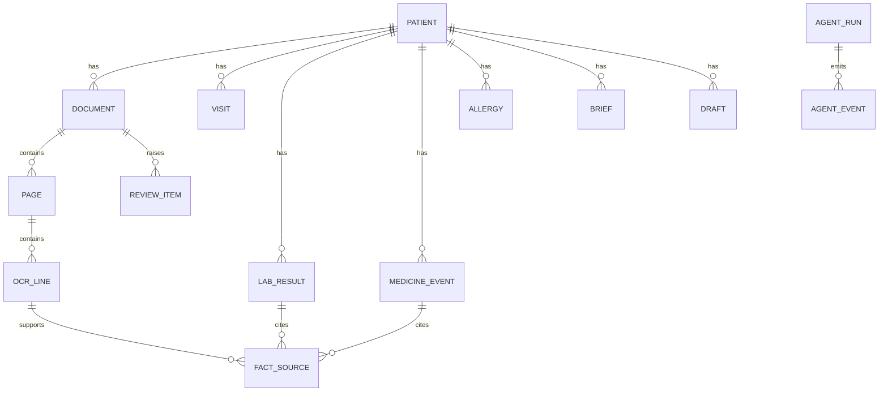

# 5. Data model

All tables use a UUID primary key and `created_at`. Only the main columns are listed here.

## Relationships

## Records

| Table | Main columns |
|---|---|
| `patient` | `mrn`, `full_name`, `date_of_birth`, `sex`, `phone`, `is_synthetic` |
| `visit` | `patient_id`, `visit_date`, `status` (`scheduled`, `completed`), `note_id` |
| `allergy` | `patient_id`, `substance`, `allergy_class`, `reaction`, `verification_status` |
| `condition` | `patient_id`, `name`, `first_recorded_on`, `verification_status` |

## Documents

| Table | Main columns |
|---|---|
| `upload_batch` | `uploaded_by`, `file_count`, `status` |
| `document` | `batch_id`, `patient_id`, `doc_type`, `doc_date`, `match_confidence`, `status` |
| `page` | `document_id`, `page_number`, `image_path`, `width`, `height` |
| `ocr_line` | `page_id`, `line_number`, `text`, `bbox`, `confidence` |
| `document_chunk` | `document_id`, `content`, `embedding`, `search_vector`, `source_line_ids` |

## Verified facts

Every fact has `verification_status`: `pending`, `verified`, `needs_review`, `corrected` or `rejected`. Only `verified` and `corrected` facts are used in trends, briefs and alerts.

| Table | Main columns |
|---|---|
| `lab_result` | `patient_id`, `test_code`, `test_name_raw`, `value_raw`, `value_numeric`, `unit_raw`, `value_normalized`, `unit_normalized`, `reference_range_raw`, `collected_on`, `verification_status` |
| `medicine_event` | `patient_id`, `medicine_raw`, `ingredient`, `dose`, `frequency`, `event_type` (`recorded`, `started`, `changed`, `stopped`), `event_date`, `verification_status` |
| `fact_source` | `fact_type`, `fact_id`, `ocr_line_id` |
| `review_item` | `item_type`, `reference_id`, `reason`, `suggested_value`, `status`, `resolved_value`, `resolved_by`, `resolved_at` |

The original values are always kept. A correction adds `resolved_value` and never overwrites the source text.

## Insights and drafts

| Table | Main columns |
|---|---|
| `trend_finding` | `patient_id`, `test_code`, `direction`, `first_value`, `last_value`, `start_date`, `end_date`, `point_count`, `method_details`, `explanation` |
| `change_item` | `patient_id`, `since_date`, `change_type`, `summary`, `source_refs` |
| `missing_record_alert` | `patient_id`, `rule_code`, `last_seen_on`, `summary` |
| `brief` | `patient_id`, `visit_id`, `content`, `source_refs`, `status`, `generated_at` |
| `replay_script` | `patient_id`, `events_json`, `generated_at` |
| `draft` | `patient_id`, `visit_id`, `draft_type`, `content`, `transcript_id`, `status`, `approved_by`, `approved_at` |
| `transcript` | `visit_id`, `audio_path`, `text`, `engine`, `uncertain_terms` |
| `safety_alert` | `draft_id`, `alert_type`, `medicine`, `matched_record_ref`, `doctor_action`, `acknowledged_at` |

`draft_type` can be `visit_note`, `prescription`, `patient_instructions`, `referral_letter`, `medical_certificate` or `follow_up_message`.

`draft.status` can be `draft`, `blocked`, `approved` or `rejected`.

## Reference data

| Table | Main columns |
|---|---|
| `lab_test` | `test_code`, `display_name`, `aliases`, `canonical_unit`, `unit_conversions`, `plausible_min`, `plausible_max`, `trend_threshold`, `body_region` |
| `medicine` | `brand_name`, `ingredient`, `allergy_class` |
| `follow_up_rule` | `rule_code`, `test_code`, `max_interval_days`, `applies_to_condition` |

All reference data must be reviewed by a doctor before the demo.

## System

| Table | Main columns |
|---|---|
| `app_user` | `name`, `role` (`doctor`, `assistant`), `password_hash` |
| `job` | `job_type`, `payload`, `status`, `attempts`, `locked_at`, `error` |
| `agent_run` | `agent_name`, `job_id`, `patient_id`, `model`, `prompt_version`, `input_refs`, `output`, `status`, `duration_ms`, `input_tokens`, `output_tokens` |
| `agent_event` | `run_id`, `event_type`, `message`, `created_at` |
| `audit_log` | `actor_type`, `actor_id`, `action`, `target_type`, `target_id`, `details` |
