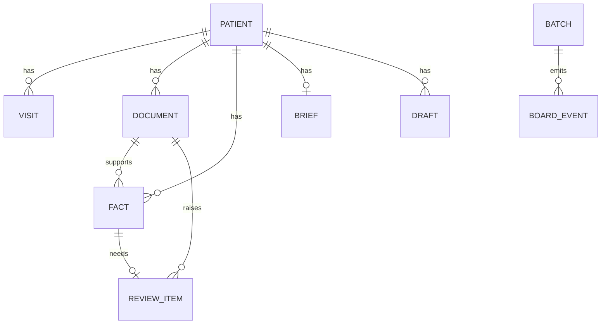

# 5. Data model

The full schema is in [schema.sql](../backend/app/schema.sql).

## Relationships

## Tables

| Table | What it holds |
|---|---|
| `patient` | File number, name, date of birth and sex |
| `visit` | Past visits and today's appointment |
| `batch` | One upload, and whether it used saved results |
| `document` | One page, with its image, type, date and search text |
| `fact` | One lab value, medicine, allergy or condition, with its position on the page |
| `review_item` | Anything waiting for a person to check |
| `brief` | The latest brief for each patient |
| `draft` | Visit notes, prescriptions, instructions, letters, certificates and reminders |
| `agent_run` | The activity log |
| `board_event` | Live steps for the Agent Board |

## How facts are trusted

Every fact has a status:

| Status | Meaning | Used in trends, briefs and alerts? |
|---|---|---|
| `verified` | Passed the second reading and code checks | Yes |
| `corrected` | Confirmed by a person | Yes |
| `needs_review` | Waiting for a person | No |
| `rejected` | Removed by a person | No |

The AI's first reading is always kept in `original_value`, so a correction never erases it.

## Reference data

Lab tests, medicines and follow-up rules are stored in [reference.py](../backend/app/reference.py). All of it must be reviewed by a doctor before anyone relies on it.
